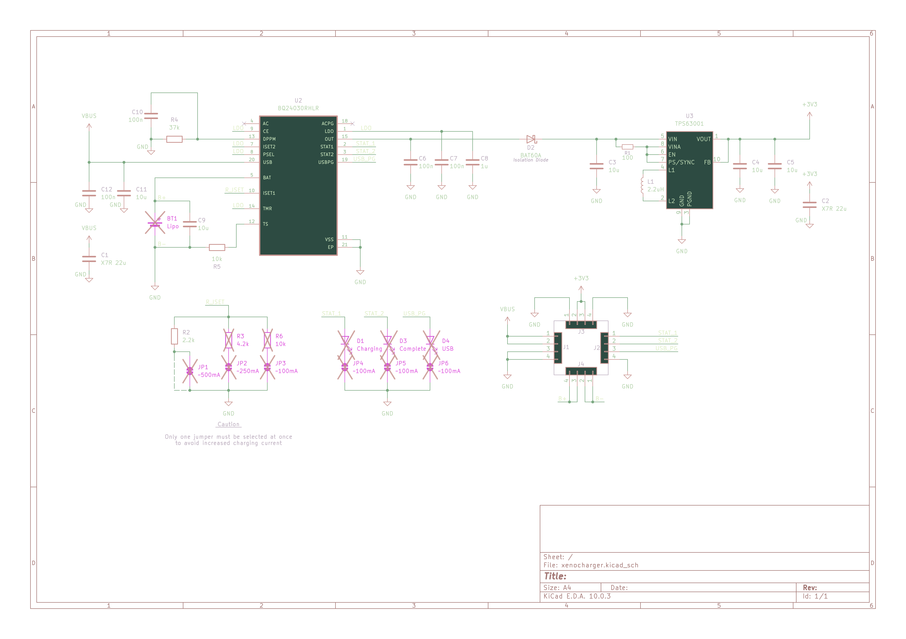
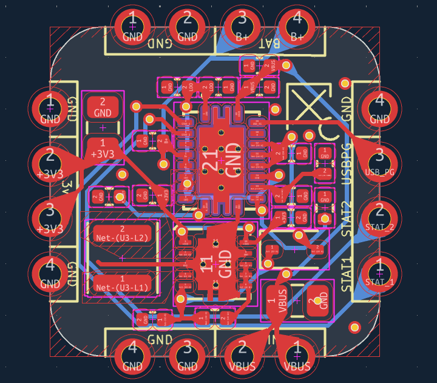
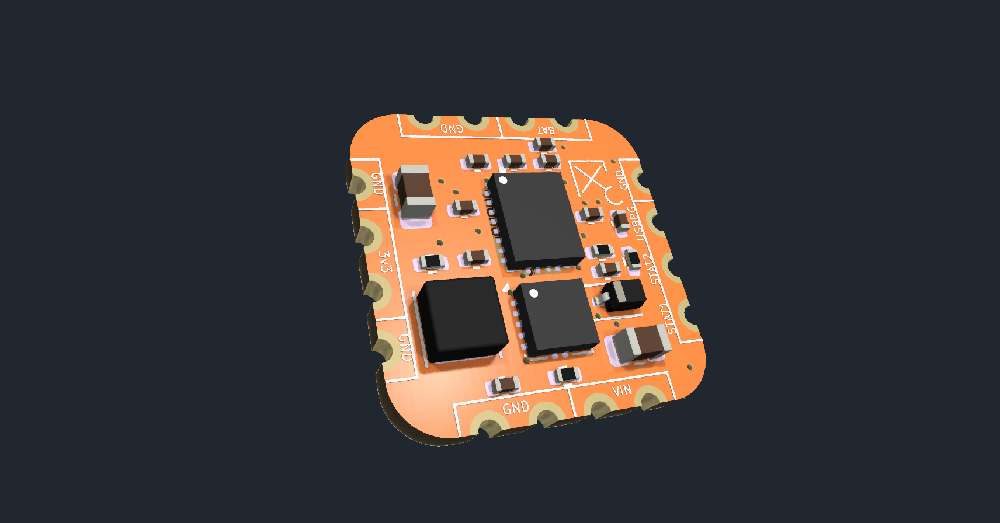

# xenocharger
xenocharger is a compact 15.24mm x 15.24mm (0.6mil x 0.6mil) lipo charger and regulator packed with a ton of features! it can charge a battery 500mA, power projects up to 600mA on 3.3V, with features such as DPPM and trickle charging! It's powered by the BQ24030 IC and TP63001 from TI.

## PCB
the PCB is a compact 2 layer board that uses castellated holes to save even more spaces. 4 sets of headers are broken out, one for the battery, one for the input, one for the output and one for charge status.

## BOM
This is a rough BOM for the costs for this project. A PCB BOM can be found in pcb/prod/bom.csv, and the project BOM is just BOM.csv in the root of this repository.

ICs 
- TPS63001
- BQ24030

Other
- 1x BAT60A Diode

Passives
- 4x 100nF 0402
- 1x 1uF 0402
- 5x 10uF 0402
- 2x 22uF X7R 0402
- 1x 10kOhm 0402
- 1x 2.2kOhm 0402
- 1x 36kOhm 0402
- 1x 100Ohm 0402
- 1x SWPA3015S2R2MT 2.2uH